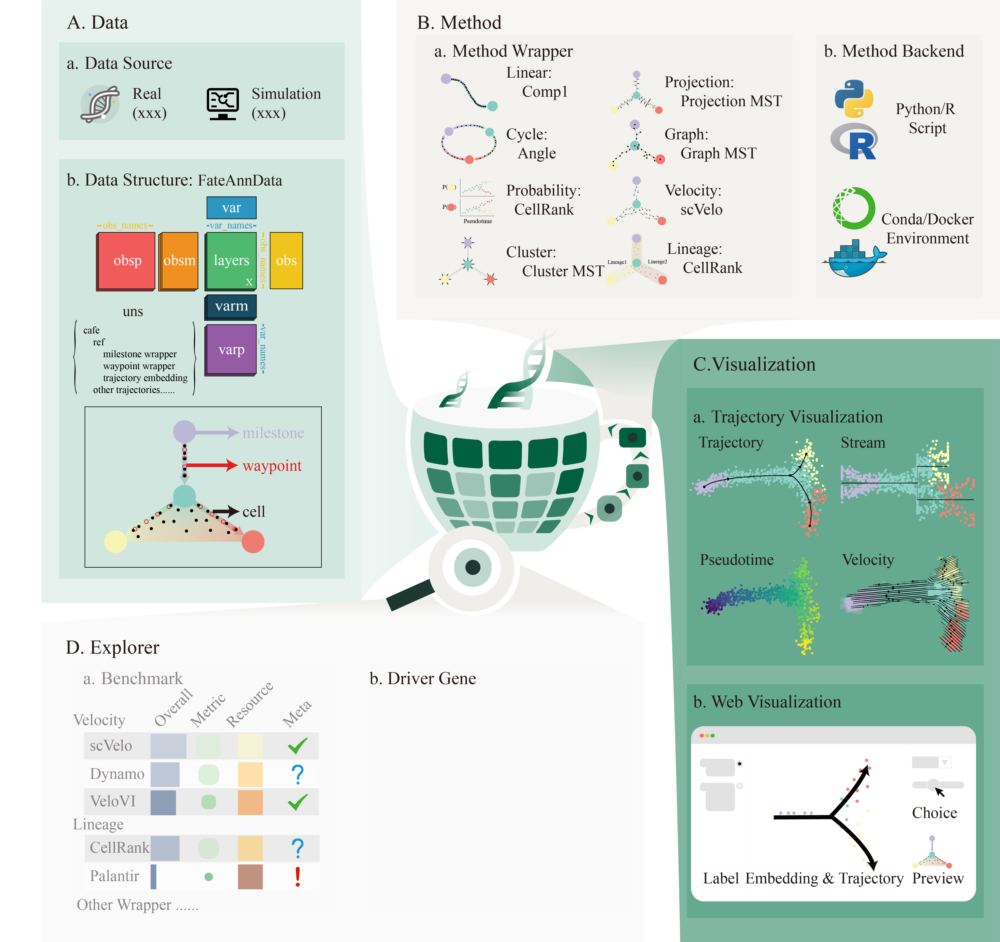

[](https://github.com/HuangDDU/CellFateExplorer/actions/workflows/test.yml)
[](https://cellfateexplorer.readthedocs.io/en/latest/)
[](https://pypi.org/project/cafe-release)
[](https://github.com/HuangDDU/CellFateExplorer/blob/main/LICENSE)


# Cafe: An integrated platform for exploring cell fate

**Cafe (Cellular Fate Explorer)** is a modular framework to study cellular dynamics based on single-cell RNA-seq data. It provides an integrated platform for *inferring*, *visualizing* and *benchmarking* cell fate trajectories.

## Framework



## Key Applications

- **Trajectory Inference**: Infer cell fate trajectories using various backend methods (including Python-based, Docker-based, and Conda-based backends).
- **Visualization**: Visualize trajectories, embeddings, pseudotime, and velocity fields with high-quality plots.
- **Benchmarking**: Compare different trajectory inference methods using comprehensive metrics including topology, cluster, and feature importance.
- **Data Management**: Manage complex single-cell data structures with `FateAnnData`, extending the capabilities of AnnData for trajectory analysis.

## Documentation

Comprehensive documentation is available at [here](https://cafe-release.readthedocs.io/en/latest/), including installation, tutorial, API and so on.

## Citation

If you use Cafe in your research, please cite:

```bibtex
@article{huang2025cellfateexplorer,
    title={CellFateExplorer: An integrated platform for exploring cell fate},
    author={Huang, Zhaoyang and Ma, Haonan and Peng, Yuchuan and Zhao, Chenguang and Yu, Liang},
    journal={bioRxiv},
    pages={2025--02},
    year={2025},
    publisher={Cold Spring Harbor Laboratory}
}
```
